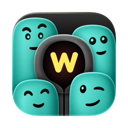

  

<h1 align="center">Wassup</h1>

A private native WhatsApp client for macOS that keeps the remotely deleted messages, based on [ZapFast](https://github.com/crmne/zapfast)
0.21.1. It saves received messages, message revisions, and ordinary attachments
to a separate local archive while it is running and connected.

The archive is in `~/Wassup`. Markdown files provide a readable view;
the SQLite journal preserves the original observations. Sender deletion does
not delete this separate copy. Messages that never reach this client and files
that do not finish downloading cannot be guaranteed.

The external archive is unencrypted plaintext and can be read outside the app.
App and chat locks do not protect these files. Keep this folder and its backups
private. View-once media, calls, statuses, channels, and historical backfill are
outside permanent capture. Ordinary attachments are limited to 2 GB each, and
downloads preserve at least 1 GB of free space.

Open **Deleted** to select a sender and read retained originals in capture order,
with the source chat shown. **Details** contains revisions, attachments, and the
saved transcript link. Search covers loaded messages; use **Load more** for older
copies. In a narrow window, **Back to senders** returns to the list.

Normal chats still follow WhatsApp deletions. The Deleted tab shows only chats
known to be unlocked. Removing a whole chat can hide its copies from the tab
when its lock metadata is gone; the external archive remains intact.

Wassup uses its own profile and WhatsApp link. It keeps running when its window
closes, requests login registration on its first supported launch, and disables
upstream automatic updates. It remains an unofficial WhatsApp client, with the
account-suspension risk described by upstream ZapFast.

Build on Apple Silicon macOS with the Rust toolchain in
[rust-toolchain.toml](rust-toolchain.toml), Xcode Command Line Tools, CMake,
and Python 3.11 or later.

Run `scripts/build-wassup-macos.sh` to create `dist/Wassup.app`; the script does
not install or launch it.

The inherited source is MIT licensed. See [LICENSE](LICENSE) and
[THIRD-PARTY-NOTICES.md](THIRD-PARTY-NOTICES.md).
